<p align="center">
  <picture>
    <source media="(prefers-color-scheme: dark)" srcset="docs/images/hero-dark.png">
    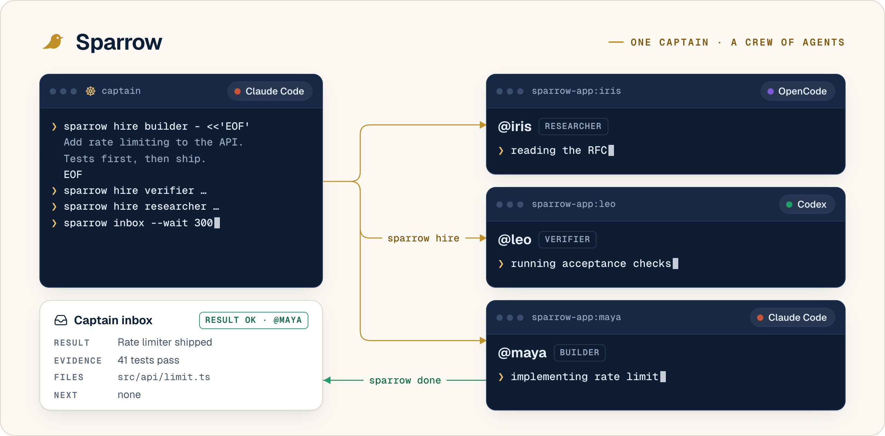
  </picture>
</p>

<h1 align="center">Sparrow</h1>

<p align="center"><b>One captain. Every harness. No message overboard.</b></p>

<p align="center">
Turn your coding session into a captain that hires Claude Code, Codex and OpenCode agents into real terminals,
talks to all of them over one small protocol, and gets work back with receipts.<br>
Local, open source, and it runs on the subscriptions you already pay for.
</p>

<p align="center">
  <a href="#install">Install</a> ·
  <a href="#how-it-works">How it works</a> ·
  <a href="docs/getting-started.md">Getting started</a> ·
  <a href="docs/README.md">Docs</a> ·
  <a href="#faq">FAQ</a>
</p>

<p align="center">
  <a href="LICENSE"></a>
  <a href="https://www.npmjs.com/package/sparrow-agents"></a>
  
  
</p>

---

You pay for Claude. You pay for ChatGPT, so you have Codex. You put money on OpenCode because someone on X said
Kimi got good. Then every task goes to Claude, Claude hits its weekly limit by Wednesday, and the other two sit
there like a gym membership.

It isn't laziness. Each harness is an island. Spreading work across them means four terminals, copying context by
hand, and pasting one agent's output into the next one's prompt. The message bus between your agents is you, with
Cmd+C.

Sparrow does the boring part. Your session hires a crew. Each agent works in its own real terminal on whatever
harness its resume names, and they all report back through the same CLI. You plan and review. They row.

<p align="center">
  <picture>
    <source media="(prefers-color-scheme: dark)" srcset="docs/images/problem-dark.png">
    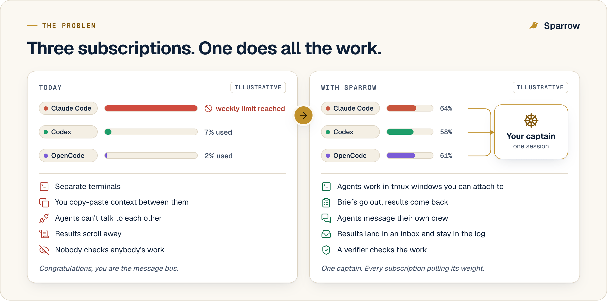
  </picture>
</p>

## Install

You need macOS or Linux, [tmux](https://github.com/tmux/tmux/wiki/Installing), and at least one of
[Claude Code](https://code.claude.com), [Codex](https://github.com/openai/codex) or [OpenCode](https://opencode.ai),
logged in.

<!-- install: finalize after oss/dist merge -->
```sh
curl -fsSL https://raw.githubusercontent.com/vermarjun/Sparrow/main/install.sh | sh
sparrow
```

The first `sparrow` sets itself up, checks which harnesses you have, starts a local server on `127.0.0.1:4040` and
opens the UI. Package managers work too:

```sh
npm i -g sparrow-agents            # or: npx sparrow-agents, bunx sparrow-agents
brew install vermarjun/tap/sparrow
```

## Your first voyage

Open Claude Code in any repo and ask for a crew. Sparrow ships a `sparrow-captain` skill, so plain English works.

> Use Sparrow. Hire a builder to add rate limiting to POST /login, then a verifier to check it.

Your session is now `@captain`. Under the hood it runs:

```sh
sparrow hire builder - <<'EOF'
Goal: rate-limit POST /login, 5 tries per 15 minutes per IP.
Acceptance: bun test green, including a test that the 6th attempt gets a 429.
EOF
```

A Claude Code window opens in tmux as `@maya`, does the work, and reports:

```text
── @maya · builder · done ok · call 6m12s ──
## Result    Sliding-window limiter on POST /login, keyed by IP (src/auth/limit.ts).
## Evidence  bun test → 48 pass, 0 fail, including "6th attempt returns 429"
## Files     src/auth/limit.ts, src/routes/login.ts, test/auth/limit.test.ts
## Next      Counts live in memory. Move them to Redis before you run two instances.
```

The captain hands maya's evidence to a Codex verifier, gets a PASS/FAIL table back, and sends the one failure to
`@maya`, which wakes up in the same session, remembers everything and fixes it. Everyone gets released once it's
merged.

<p align="center">
  <picture>
    <source media="(prefers-color-scheme: dark)" srcset="docs/images/workflow-dark.png">
    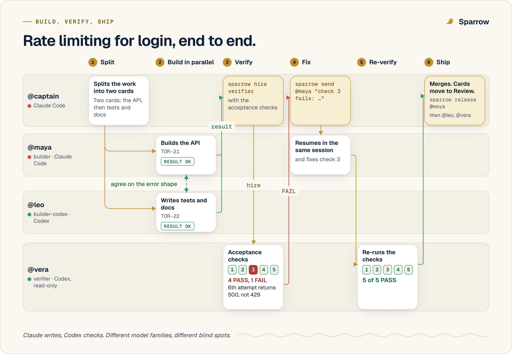
  </picture>
</p>

## How it works

<p align="center">
  <picture>
    <source media="(prefers-color-scheme: dark)" srcset="docs/images/how-it-works-dark.png">
    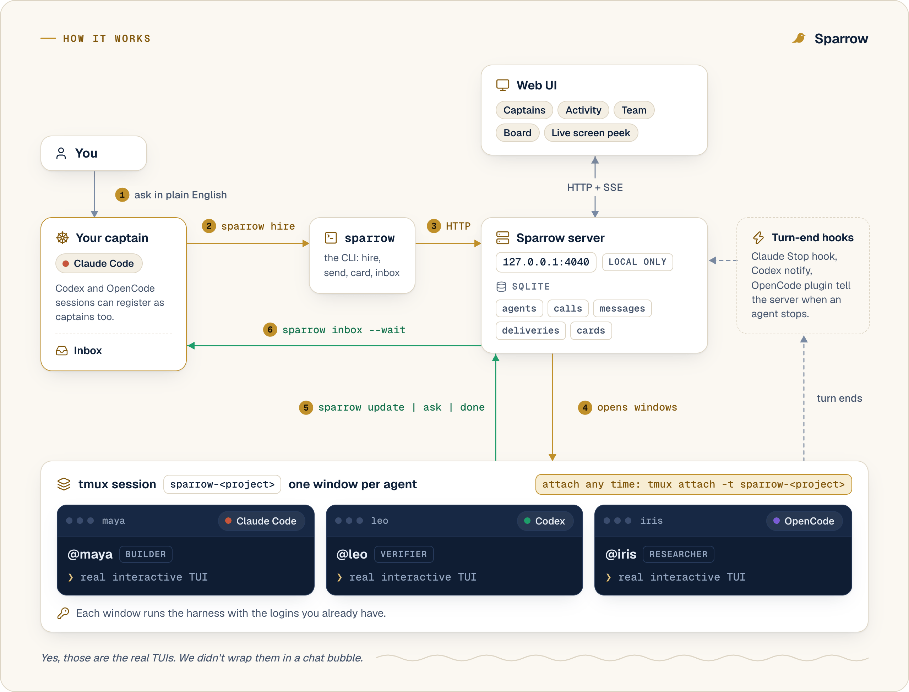
  </picture>
</p>

- **The captain is your session.** Claude Code becomes a captain the first time it runs `sparrow`. One captain per
  feature, as many as you like per repo, each with a private crew.
- **The crew are real TUIs.** Each agent is the actual `claude`, `codex` or `opencode` interface in its own tmux
  window, on your own login. Attach, scroll, poke it. Nothing is wrapped or emulated.
- **Everyone speaks one CLI.** `hire`, `send`, `update`, `ask`, `done`, `wait`, `inbox`. Messages live in SQLite on
  your machine. Hooks in each harness tell the server when a turn ends, so a silent agent gets noticed.

<p align="center">
  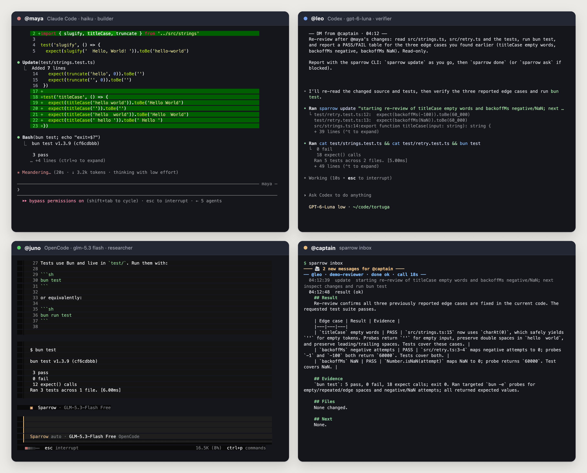
  <br><sub>Not a mockup. Three harnesses, three subscriptions, one inbox.</sub>
</p>

## Why you'll keep it

### Every subscription pulls its weight

<p align="center">
  <picture>
    <source media="(prefers-color-scheme: dark)" srcset="docs/images/resumes-dark.png">
    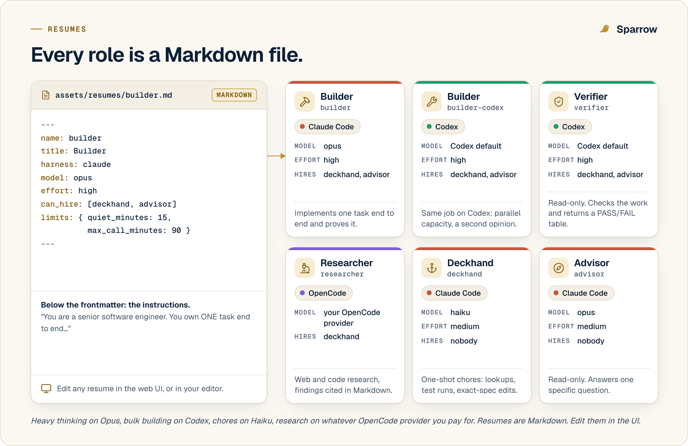
  </picture>
</p>

You hire from **resumes**, Markdown role cards that pick the harness, model, effort, skills and who the role may
hire. Heavy thinking on Opus, bulk building on Codex, chores on Haiku, research on whatever OpenCode provider you pay
for. Eight ship by default. Edit them in the UI, or write your own.

### Your context window stays yours

The captain never reads a 3,000-line diff to find out if something worked. Agents do the reading in their own fresh
context and hand back four sections: Result, Evidence, Files, Next. Evidence means the commands they ran and the real
output. A one-shot deckhand retires the moment it reports, so its context never grows, and released agents never
wake, so yesterday's context never leaks into today's job.

### Finished agents remember

<p align="center">
  <picture>
    <source media="(prefers-color-scheme: dark)" srcset="docs/images/lifecycle-dark.png">
    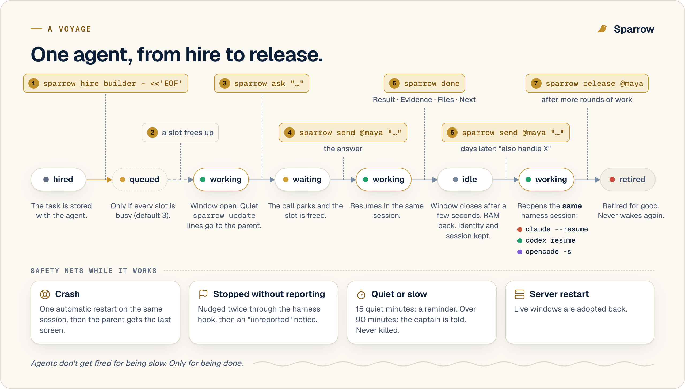
  </picture>
</p>

When an agent reports, its window closes and you get the RAM back. Message it tomorrow and it reopens the same harness
session, so a follow-up doesn't start with re-explaining the codebase. Release it when the job is merged. Release is
permanent on purpose.

### No message overboard

<p align="center">
  <picture>
    <source media="(prefers-color-scheme: dark)" srcset="docs/images/protocol-dark.png">
    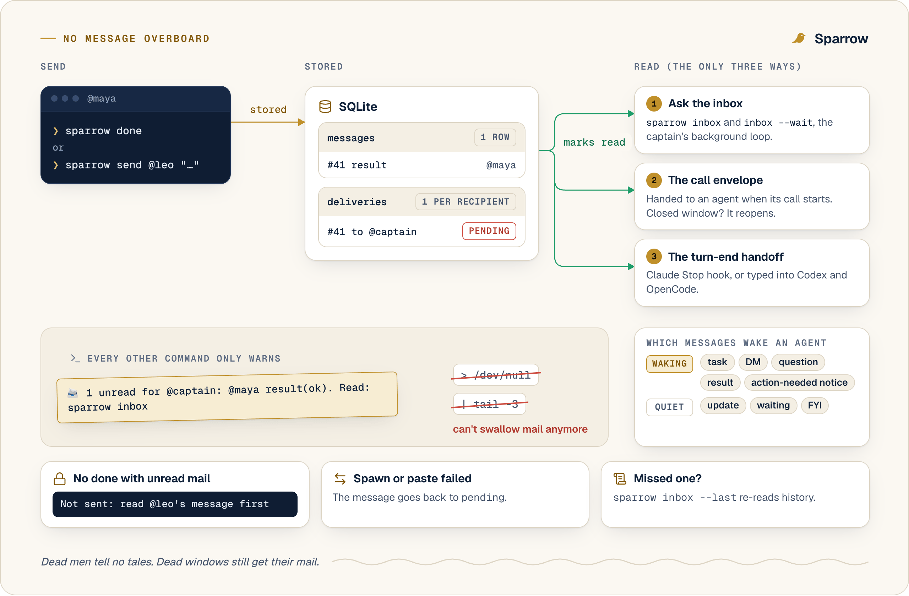
  </picture>
</p>

Every message hits SQLite before anyone sees it. A task, DM, question or result stays unread until its recipient
actually reads it, with `sparrow inbox` or when Sparrow hands it over at the start or end of an agent's turn. Every
other command leaves it alone. The ones that know who you are print a one-line `📨 2 unread` notice to stderr, so
`> /dev/null` and `| tail` can't swallow a result. Agents can't sign off with unread mail. A message to an agent
whose window closed reopens it.

### A crew, not a pile of tabs

<p align="center">
  <picture>
    <source media="(prefers-color-scheme: dark)" srcset="docs/images/crew-dark.png">
    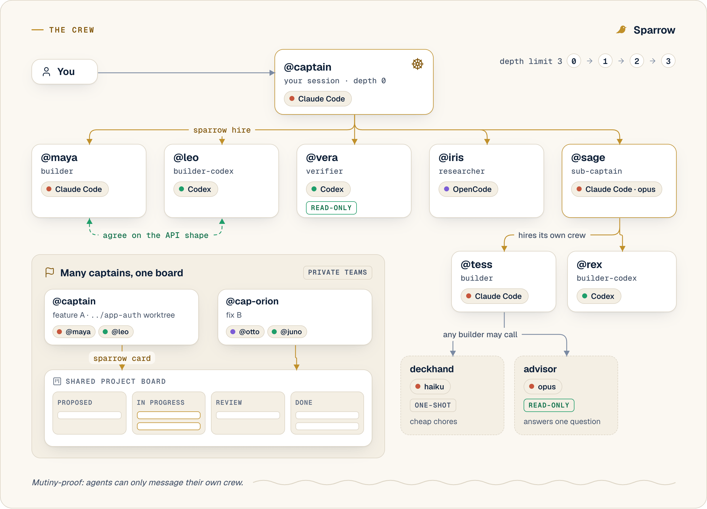
  </picture>
</p>

Sub-captains hire their own builders. Builders call a deckhand (Haiku, one-shot) for chores or an advisor (Opus,
read-only) for a second opinion. Teammates DM each other to agree on an API without you relaying it. Crews are
private and depth stops at 3, so nobody hires their way into a pyramid scheme.

### A board the crew writes on

<p align="center">
  <picture>
    <source media="(prefers-color-scheme: dark)" srcset="docs/images/board-dark.png">
    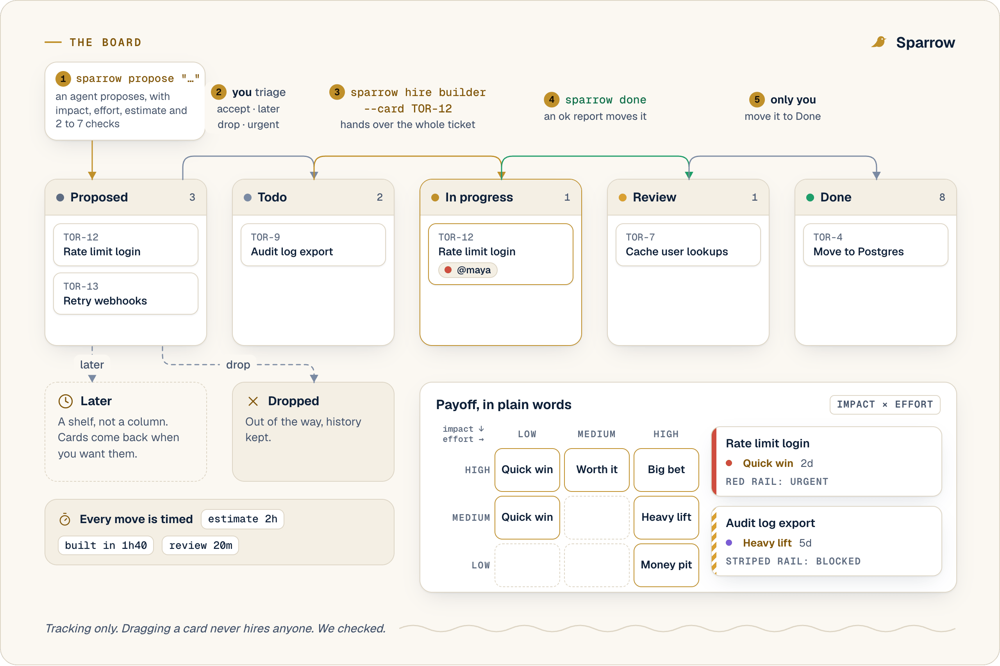
  </picture>
</p>

Agents propose tickets with impact, effort and an estimate. You triage them from the keyboard.
`sparrow hire builder --card TOR-12` hands an agent the whole ticket, and its `done` moves the card to Review. Only
you move things to Done. Every move is timed, so you see the estimate next to what it really took.

### Safety nets, because agents are agents

- Stopped without reporting? Nudged twice through the harness's own hook, then you hear about it.
- Quiet for 15 minutes? A reminder. Past 90 minutes? You're told. Nobody gets killed for being slow.
- Crashed? Restarted once on the same session, then you get its last screen.
- More hires than slots? They queue and start when one frees up.
- Server restarted? Live windows are adopted back.

## The UI

<p align="center">
  <picture>
    <source media="(prefers-color-scheme: dark)" srcset="docs/images/ui-board-dark.png">
    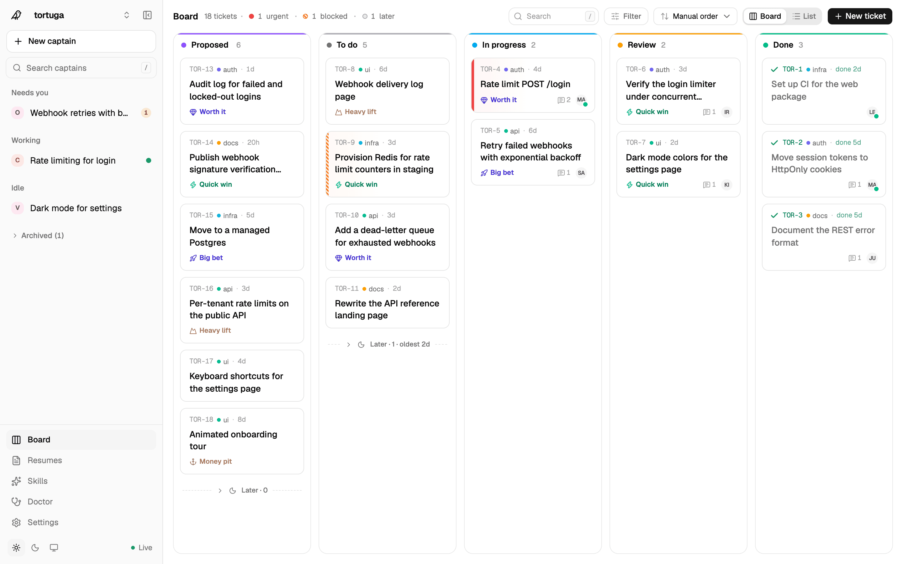
  </picture>
</p>
<p align="center">
  <picture>
    <source media="(prefers-color-scheme: dark)" srcset="docs/images/ui-activity-dark.png">
    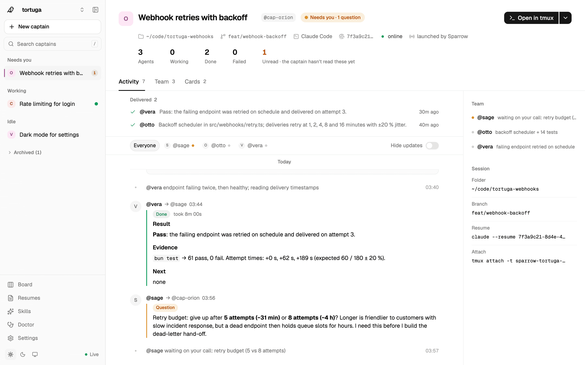
  </picture>
  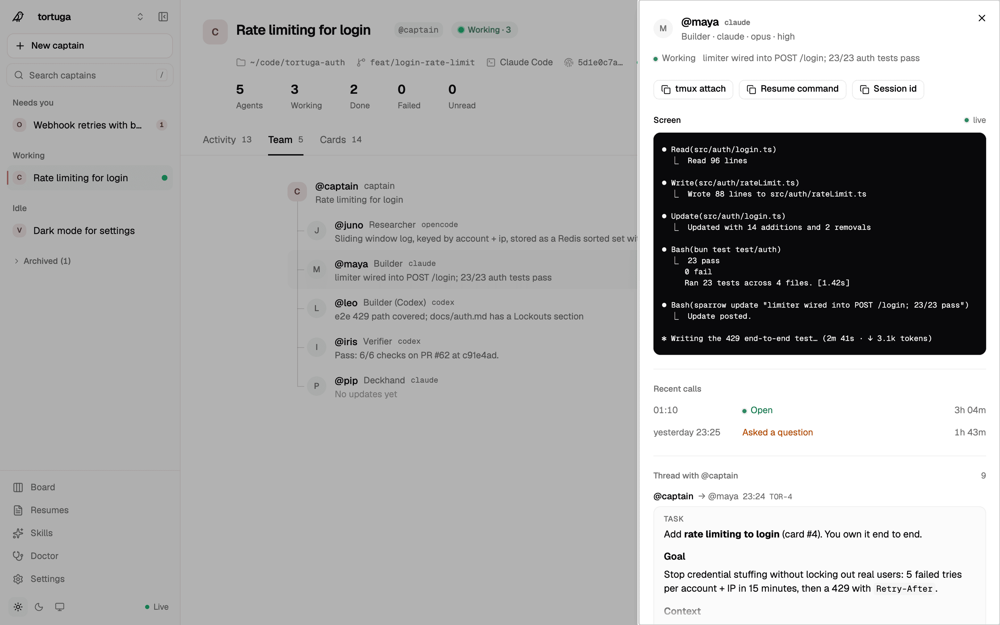
</p>

Captains, each crew's activity, a team tree with a live peek at every agent's screen, the board, a resume editor and
a doctor that tests your harnesses. The UI never hires anything by itself. Your captain does that.

## Sparrow vs. what you already have

Native team features got much better in 2026, so here's an honest map as of October 2026.

| | Sparrow | Claude Code subagents and agent teams | Codex and OpenCode subagents | Session managers like Claude Squad, Agent of Empires, Conductor |
|---|---|---|---|---|
| Claude Code, Codex and OpenCode in one team | ✓ | Claude only | One harness each | Side by side, not one team |
| Every worker is a real TUI you can attach to | ✓ tmux | Agent teams in tmux split mode | Thread views inside the harness | ✓ |
| Workers report back over a protocol, with evidence | ✓ | ✓ inside Claude | ✓ to the parent | You read the terminals |
| Message a finished worker, same session | ✓ | ✓ | ✓ | While the session lives |
| Tickets the agents write themselves | ✓ | Shared task list | ✗ | Varies |
| Git worktrees made for you | ✗ | ✗ | ✗ | ✓ |

If you want a bigger machine, look at [Gas Town](https://github.com/gastownhall/gastown),
[Orchestrator.inc](https://github.com/OrchestratorInc/agent-orchestrator) and [Ruflo](https://github.com/ruvnet/ruflo).
They're full orchestrators with planners, merge gates and a vocabulary of their own. Sparrow is the small one. Your
session is the captain, the protocol is a handful of CLI verbs, and every worker is the harness you already know.

## FAQ

**Is it safe?** Agents run with their harness's auto-approve flag (`--dangerously-skip-permissions`, `--yolo`,
`--auto`) as your user. It's a pirate ship, not a cruise liner. The server listens on 127.0.0.1 only and has no auth.
Read [SECURITY.md](SECURITY.md) before you point a crew at anything you love.

**Do I need API keys?** No new ones. Each agent uses the login its harness already has. Your plan's usage limits
still apply, and five agents use them five times faster.

**Does it make git worktrees?** No. Your captain can make one and pass `--cwd`. Every worktree of a repo shares one
board.

**Can the captain be Codex or OpenCode?** Their terminal sessions can register as captains and hire. `sparrow captain`,
which launches a fresh captain in tmux for you, is Claude Code only for now.

**Windows?** Maybe through WSL2, since it needs tmux. Not tested yet.

**Why "Sparrow"?** A captain's job is to ship. And Captain Jack never rowed his own boat.

## Docs

[Getting started](docs/getting-started.md) · [Concepts](docs/concepts.md) · [CLI](docs/cli.md) ·
[Configuration](docs/configuration.md) · [Troubleshooting](docs/troubleshooting.md) · [Design spec](docs/DESIGN.md)

## Contributing

Bug reports, harness drivers and resumes are all welcome. Start with [CONTRIBUTING.md](CONTRIBUTING.md). Coding agents
should read [AGENTS.md](AGENTS.md) first. It explains how to run the test suite without touching your real Sparrow.

## License

[MIT](LICENSE)
